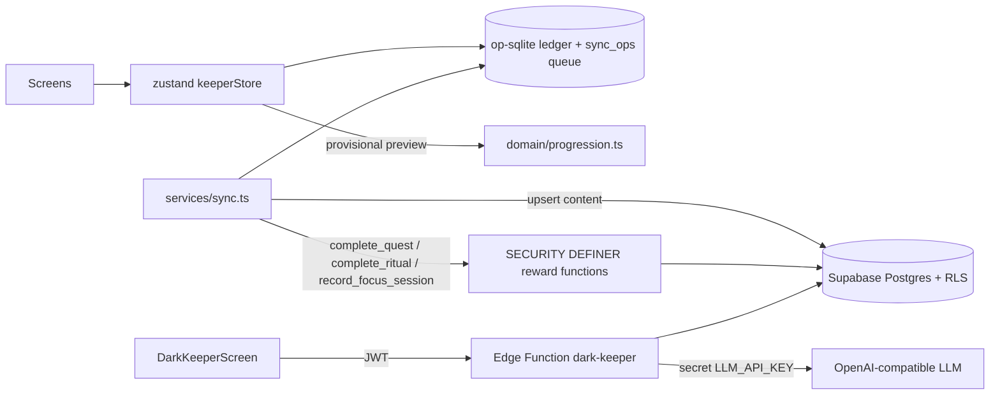

# GRAVEYARD v4.0 — Every Task Awakens a Forgotten Soul

A Halloween productivity world for Android. Quests, rituals (habits) and focus sessions earn **XP** and **Soul Energy**, which restore four regions of a haunted world. A **Dark Keeper** AI (real LLM, server-side) plans with you, and every reward is verified by the backend.

Built for **Kiroween** with React Native CLI + TypeScript, Supabase (PostgreSQL, Auth, Edge Functions) and an offline-first SQLite ledger.

```
kiroween/
├── mobile/                 React Native 0.88 app (Android)
│   ├── src/                app code (see "Code map")
│   ├── android/            native project (+ ritual reminder module)
│   └── scripts/prepare_assets.py   sprite slicer + audio converter
├── supabase/
│   ├── migrations/         schema, RLS, reward functions, seed data
│   └── functions/dark-keeper/      AI Edge Function
├── image.png               UI sprite sheet (source art)
├── Haunted_Adventure_Audio_Pack/  source audio (WAV)
└── prd.md                  product requirements
```

## Features (PRD mapping)

| PRD module | Where |
|---|---|
| 6.1 Splash & onboarding: moon reveal, bats, fog, animated logo, story, sound permission | `SplashScreen`, `OnboardingScreen` |
| 6.2 Email sign-up/sign-in, password reset (6-digit code), session persistence, logout | `AuthScreens`, `services/auth.ts` |
| 6.3 Home: greeting, avatar, level, Soul Energy, ritual candles, active quests, world status, AI shortcut, animated scene | `HomeScreen` |
| 6.4 Quests: CRUD, deadline, priority, difficulty (10/25/50/100 XP), category, daily/weekly recurrence, search & filters | `QuestsScreen`, `QuestEditorScreen` |
| 6.5 Rituals: daily/weekly/custom days, reminders, streaks, history | `QuestsScreen` (Rituals tab), `RitualEditorScreen`, native `reminders/` |
| 6.6 World: 4 regions × 5 states (locked → restored) | `WorldScreens`, server `sync_world()` |
| 6.7 Soul Ledger: daily/weekly XP, trends, streaks, focus time, XP history, achievements | `LedgerScreen` |
| 6.8 Focus Chamber: Pomodoro, custom, short/long break, history, stats, rewards | `FocusScreen` |
| 6.9 Dark Keeper AI: chat, goal breakdown, quest generation, daily plan, weekly review, habit ideas; proposals need approval; idle/thinking/talking/celebrating/error states | `DarkKeeperScreen`, `supabase/functions/dark-keeper` |
| 6.10 Achievements: XP, badges, world restoration, cosmetics (auras) | `AchievementsScreen`, `ProfileScreen` |
| 7 Context-aware audio | `src/audio/` |
| 8 Animations + Reduce Motion | `src/components/effects.tsx`, `hooks/useMotion.ts` |
| 10–12 Backend, AI architecture, offline-first | `supabase/`, `src/db/`, `src/services/sync.ts` |

## Architecture



**Rewards are server-authoritative.** The app never writes XP, levels, achievements or world progress. Reward RPCs:

- derive XP from server data (quest difficulty, ritual schedule, focus wall-clock time), never from the client;
- are idempotent on a client-generated operation id (`sync_operations`), so retries after a flaky connection cannot double-reward;
- lock `keeper_stats` per user (`FOR UPDATE`) so concurrent rewards apply atomically;
- enforce anti-farming caps (25 rewarded quests/day, 3 Boss, 8 Hard; focus 60 XP/session and 240 min/day; ritual check-ins at most 2 days back);
- record every XP grant in `xp_transactions` (unique per source), so the ledger always equals `keeper_stats.xp`.

**Offline-first.** Every action is written to SQLite first and queued in `sync_ops`. The UI shows a *provisional* result immediately (`deriveDisplay` = last server snapshot + queued rewards, using the same rules as the server). On reconnect (NetInfo) or app foreground, the sync engine replays the queue in order and pulls the authoritative snapshot. Content conflicts resolve last-write-wins on `updated_at` (enforced by a DB trigger); completion fields are server-owned.

**Audio engine** (`src/audio/AudioEngine.ts`): one music bed + independent ambience layers per screen with 1.2 s crossfades, SFX that never overlap themselves and duck ambience while they play, separate Music/Ambience/SFX volumes (defaults 45/35/65 %), persisted preferences, pause in background, and a Focus scene that only allows gentle cues at reduced gain. Sound is opt-in during onboarding and never required to use the UI.

**Animation** uses Reanimated 4 for everything: fog banks (procedural texture), bats on wavy paths, moon glow, floating soul wisps, flickering lanterns, swaying tree, ghost companion, Dark Keeper mood states, card entrances, press feedback, progress bars, and cinematic overlays for level-ups, achievements and region unlock/restore. Loops pause when the screen is unfocused or the app is in the background, and all motion stops when Reduce Motion is on (OS setting or in-app toggle).

## Setup

### 1. Prerequisites
Node ≥ 22.11, JDK 17, Android SDK (compileSdk 37, NDK 27.1), an Android device or emulator.

### 2. Backend (Supabase)
```bash
npm i -g supabase            # or use npx supabase
supabase link --project-ref <your-project-ref>
supabase db push             # applies supabase/migrations
cp supabase/.env.example supabase/.env   # fill LLM_API_KEY, LLM_BASE_URL, LLM_MODEL
supabase secrets set --env-file supabase/.env
supabase functions deploy dark-keeper
```
In **Auth → Email Templates → Reset Password**, include `{{ .Token }}` so users receive the 6-digit recovery code the app asks for. For quick testing you can disable "Confirm email" under Auth settings.

Any OpenAI-compatible chat-completions endpoint works (OpenAI, Groq, OpenRouter, Gemini's OpenAI endpoint). Set `LLM_JSON_MODE=false` if your model does not support `response_format`.

### 3. App
Put your project URL and **anon** key in `mobile/src/config/env.ts` (the anon key is public by design; RLS protects the data). Then:
```bash
cd mobile
npm install
npm start                    # Metro
npm run android              # debug build on a device/emulator
```
Without backend keys the app still runs fully offline: choose **Continue offline as a Wandering Keeper**. Offline progress is submitted for verification if you create an account later on the same device.

### 4. Release APK
```bash
cd mobile/android
JAVA_HOME=/path/to/jdk-17 ./gradlew assembleRelease
# → app/build/outputs/apk/release/app-release.apk
```
The release build is signed with the debug key unless you define `GRAVEYARD_UPLOAD_STORE_FILE`, `GRAVEYARD_UPLOAD_STORE_PASSWORD`, `GRAVEYARD_UPLOAD_KEY_ALIAS`, `GRAVEYARD_UPLOAD_KEY_PASSWORD` in `~/.gradle/gradle.properties`.

### Re-generating assets
`mobile/scripts/prepare_assets.py` slices `image.png` into transparent sprites (background keying + component filtering), generates fog/glow textures, launcher icons, and converts the WAV pack to OGG in `res/raw` (≈30 MB → 2 MB). Requires `pillow numpy scipy` and `ffmpeg`.

## Code map (`mobile/src`)
- `domain/` — types, constants mirrored from the server seed, date helpers, progression rules
- `db/` — SQLite schema/migrations and repositories
- `services/` — Supabase client, sync engine, auth, AI client, reminders, crash log
- `store/` — zustand stores (keeper data, session, settings persisted in MMKV, UI toasts/celebrations)
- `audio/` — scene catalog, engine, hooks
- `components/` — UI kit, effects, characters, game widgets, overlays
- `screens/`, `navigation/`

## Security checklist
- No private key in the APK: only the Supabase URL + anon key; the LLM key is an Edge Function secret.
- RLS on all 20 tables; `anon` has no table privileges; progression tables are read-only for clients.
- Reward functions run as `SECURITY DEFINER` with `search_path = ''` and check `auth.uid()`.
- Edge Function: JWT verification, input validation, per-minute/per-day rate limits, daily token budget, conversation ownership checks, timeout + retry, and JSON response validation. AI proposals become quests/rituals only through `decide_ai_proposal()` after the user approves.

## Known limitations
- Motion is implemented with Reanimated only. The PRD also lists Rive, Lottie and Skia, but no `.riv`/Lottie assets were provided, so character states are Reanimated-driven sprites.
- Crash monitoring is an on-device log (Settings → Diagnostics); no hosted reporter is configured.
- `device_tokens` and `notification_preferences` exist server-side, but push notifications are not wired up. Ritual reminders are local notifications.
- Android only; iOS was not configured.
